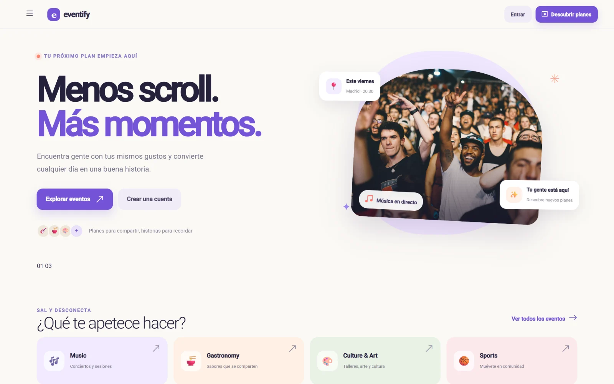
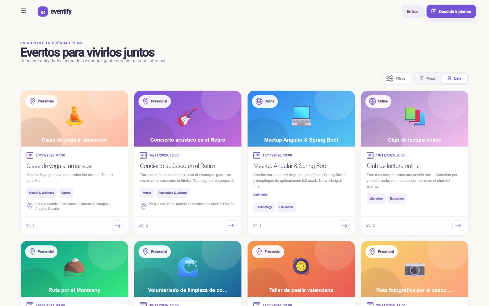
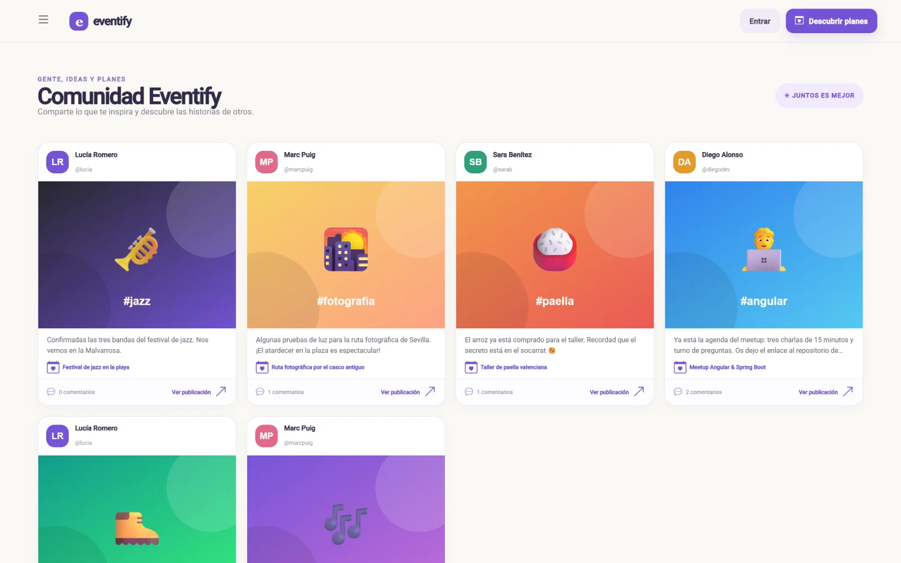
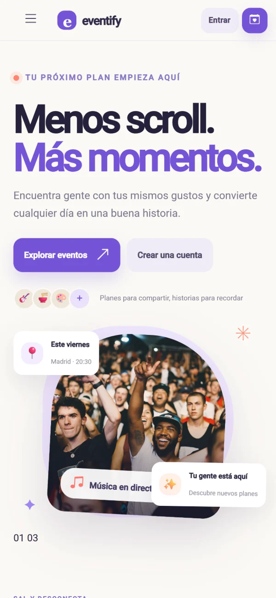
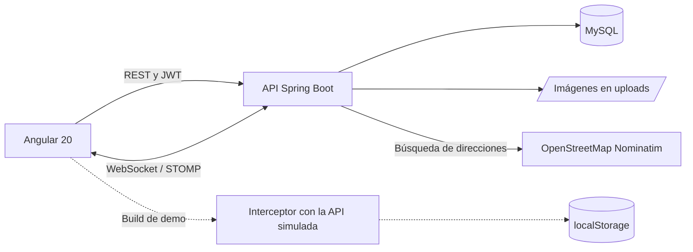

# Eventify

Planes para hacer con más gente: crea eventos online o presenciales, apúntate a los de otras personas, habla con el resto de asistentes en el chat del evento y comparte publicaciones.

**[Ver la demo](https://vanerb.github.io/eventify-angular-java/)**: funciona en el navegador, sin instalar nada.

**Stack:** Angular 20 · Tailwind CSS · Angular Material · Leaflet · Spring Boot 4 · Java 17 · Spring Data JPA · WebSocket (STOMP y SockJS) · MySQL

## Qué puedes hacer

- **Eventos:** crear, editar y borrar eventos online o presenciales, con fechas, descripción, categorías, imagen y ubicación.
- **Buscar planes:** por texto, categoría, fecha, modalidad y ubicación, en vista de lista o sobre un mapa.
- **Participar:** apuntarse a un evento y ver quién más va.
- **Chat del evento:** cada evento tiene su propio chat en tiempo real para quienes participan.
- **Comunidad:** publicaciones con texto, imagen y etiquetas, con comentarios.
- **Perfil:** biografía, foto, portada y la lista de tus eventos.

### Capturas

| Inicio | Eventos |
| --- | --- |
|  |  |

**Comunidad**



<p align="center">
  
</p>

## Demo

La demo es el frontend compilado en modo `demo`: un interceptor HTTP simula toda la API dentro del navegador, con datos de ejemplo. Tus cambios se guardan en el `localStorage` de tu navegador y el botón **Restablecer datos** del aviso inferior vuelve al estado inicial.

| Correo | Nombre |
| --- | --- |
| `lucia@eventify.demo` | Lucía Romero |
| `marc@eventify.demo` | Marc Puig |
| `sara@eventify.demo` | Sara Benítez |
| `diego@eventify.demo` | Diego Alonso |

La contraseña de todas es `Demo1234`. También puedes registrar una cuenta nueva. En la demo el chat no usa WebSocket: los mensajes se guardan en tu navegador y otro participante contesta automáticamente.

## Cómo está construido



```text
backend/     API de Spring Boot: controladores, servicios, modelos y seguridad
frontend/    Web de Angular y build de demo
database/    Base de datos de prueba para MySQL
```

## Decisiones técnicas

- **Un canal de chat por evento.** Los mensajes viajan por WebSocket con STOMP y SockJS, y cada evento tiene su propio canal.
- **Mapas sin claves de pago.** El mapa usa Leaflet con OpenStreetMap, y la búsqueda de direcciones pasa por la API, que consulta Nominatim.
- **Errores claros.** Credenciales incorrectas devuelven 401 y un correo ya registrado 409, siempre con un mensaje legible, en vez de un error interno.
- **Configuración en un solo sitio.** La URL de la API está en `frontend/src/environments/environment.ts`, y la clave de las sesiones sale de la variable `JWT_SECRET`.

## Puesta en marcha

Necesitas Node.js 20.19 o superior, Java 17 o superior (el proyecto trae Maven Wrapper, así que no hace falta instalar Maven) y MySQL 8.

**API**, en `http://localhost:8080`:

```bash
cd backend
./mvnw spring-boot:run
```

En Windows, usa `.\mvnw.cmd spring-boot:run`. Hibernate crea las tablas al arrancar, pero la base `eventify_db` tiene que existir (o importar los datos de prueba, que la crean).

**Web**, en `http://localhost:4200`, desde otra terminal:

```bash
cd frontend
npm install
npm start
```

Para abrir la demo en local, sin backend: `npx ng serve --configuration demo`.

### Configuración

| Variable | Por defecto | Uso |
| --- | --- | --- |
| `SPRING_DATASOURCE_URL` | `jdbc:mysql://localhost:3306/eventify_db` | Conexión con MySQL. |
| `SPRING_DATASOURCE_USERNAME`, `SPRING_DATASOURCE_PASSWORD` | `root`, vacío | Credenciales de MySQL. |
| `JWT_SECRET` | Clave de desarrollo | Firma de las sesiones. Si despliegas el proyecto, define una propia y larga. |
| `SERVER_PORT` | `8080` | Puerto de la API. |

Si cambias el puerto o la dirección de la API, cambia también `apiUrl` en [`frontend/src/environments/environment.ts`](frontend/src/environments/environment.ts).

### Datos de prueba

[`database/eventify_prueba.sql`](database/eventify_prueba.sql) crea la base `eventify_db` con usuarios, eventos, publicaciones, comentarios y mensajes inventados. No borra nada: si las tablas ya existen, la importación se detiene con un error.

```bash
mysql -u root -p --default-character-set=utf8mb4 -e "source database/eventify_prueba.sql"
```

Cuentas: `laura@eventify.test`, `hugo@eventify.test`, `sara@eventify.test` e `ivan@eventify.test`. La contraseña de todas es `Usuario123*`. Es pública, así que no uses estas cuentas fuera de un entorno local.

## Tests

Todavía no tiene tests propios: solo las pruebas de creación que Angular genera para cada componente.

## Limitaciones conocidas

- La API no tiene tests automáticos.
- La búsqueda de direcciones depende del servicio público de Nominatim y de sus límites de uso.
- Las imágenes se guardan en el disco del servidor, así que un despliegue real necesitaría almacenamiento persistente.

## Autoría

Proyecto de portfolio de **Vanesa Ribera Bautista** ([vanerb](https://github.com/vanerb)).
